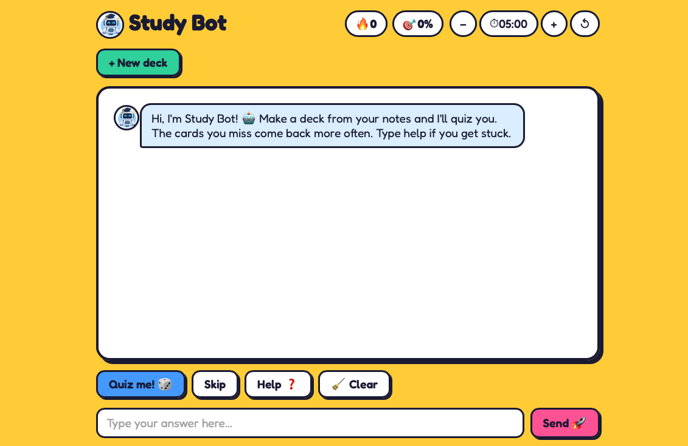

# 🤖 Study Bot

Study Bot is a web app I built using Python, Flask, and JavaScript to make studying easier and more interactive. It lets you turn your notes into flashcards, take quizzes, and keep track of how well you're doing.

## ✨ Features

- **Flashcards:** Create your own study decks using notes and definitions.
- **Chat Quizzes:** Answer questions through a chatbot-style interface.
- **Smart Review:** Cards you get wrong show up sooner, while cards you know appear less often.
- **Answer Checking:** Checks your answers by comparing important words.
- **Progress Tracking:** See your accuracy, current streak, and best streak.
- **Study Timer:** Includes a timer to help you stay focused.
- **Mobile Friendly:** Works on phones, tablets, and computers.
- **Offline Mode:** Study in your browser without needing to run Python.

## 🛠️ Built With

- **Python** – Handles the quiz logic.
- **Flask** – Connects the website to the backend.
- **SQLite** – Saves flashcards and study progress.
- **JavaScript** – Makes the website interactive.
- **HTML & CSS** – Creates the website's design.

## 🚀 How to Run It

First, download the project:

```bash
git clone https://github.com/Learning35/study-bot.git
cd study-bot
```

Create and activate a Python virtual environment:

```bash
python3 -m venv venv
source venv/bin/activate
```

Install the required packages:

```bash
pip install -r requirements.txt
```

Start the app:

```bash
python app.py
```

Open `http://127.0.0.1:5000` in your browser.

You can also use the browser-only version by opening `index.html` with Live Server in VS Code.

## 📚 How It Works

1. Create a study deck by adding your notes.
2. Choose the deck you want to study.
3. Let Study Bot quiz you on your flashcards.
4. Type your answers and see how you did.
5. Keep practicing to improve your score.

Study Bot also remembers which cards you struggle with so you can practice them more often.

## 📸 Screenshots



## 🔮 Future Plans

Some features I want to add later:

- Use AI to create flashcards from notes.
- Let AI explain answers when you get something wrong.
- Allow users to upload study materials.
- Add more ways to track study progress.
- Let users edit individual flashcards.

## 💻 Why I Built This

I wanted to build something that could help students study while also improving my programming skills. This project gave me a chance to work with Python, build a website, use a database, and connect everything together.

I plan to keep improving Study Bot as I learn more about software development.